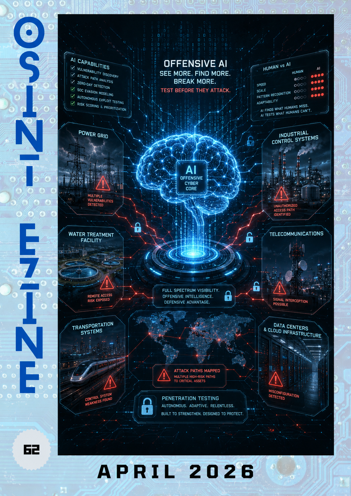

# 04 - April 2026

<figure><figcaption></figcaption></figure>

Welcome to the April issue of the OSINT eZine ([_#62_](https://therealguyinblack.gitbook.io/osint-ezine/osint-ezine/2026)). This issue includes topics such as the Claude Mythos "revolution"; military AI industry; sovereign drone ecosystems; North Korean crypto theft analysis; PRC narratives in Arabic media; government passwords exposed; conspiracy theories and disinformation learning resources; AdInt and surveillance technologies; digital sovereignty; share-link investigations… and much more!

Hey Ho, Lets Go!:

* [AI: **Claude Mythos Preview.**](04-april-2026.md#ai-claude-mythos-preview)
* [AI: **Mapping the Military AI Industry.**](04-april-2026.md#ai-mapping-the-military-ai-industry)
* [Crypto: **North Korea Crypto Theft.**](04-april-2026.md#crypto-north-korea-crypto-theft)
* [Defence: **Russia Sovereign Drone Ecosystem.**](04-april-2026.md#defence-russia-sovereign-drone-ecosystem)
* [Learning: **Weaponised Suspicion (Conspiracy Theories and Disinformation).**](04-april-2026.md#learning-weaponised-suspicion-conspiracy-theories-and-disinformation)
* [News: **France Linux Desktop Plan.**](04-april-2026.md#news-france-linux-desktop-plan)
* [Privacy: **Global Telecom Exploitation.**](04-april-2026.md#privacy-global-telecom-exploitation)
* [Privacy: **Hungarian Government Passwords Exposed.**](04-april-2026.md#privacy-hungarian-government-passwords-exposed)
* [Privacy: **Matrix and Digital Sovereignty.**](04-april-2026.md#privacy-matrix-and-digital-sovereignty)
* [Privacy: **Penlink Geolocation Surveillance Tech.**](04-april-2026.md#privacy-penlink-geolocation-surveillance-tech)
* [Techniques: **Human Judgement in OSINT.**](04-april-2026.md#techniques-human-judgement-in-osint)
* [Techniques: **PRC Narratives in Arabic Media.**](04-april-2026.md#techniques-prc-narratives-in-arabic-media)
* [Tools: **ShareTrace.**](04-april-2026.md#tools-sharetrace)

***

### AI: Claude Mythos Preview.

Anthropic’s red team published details on Claude Mythos Preview, a limited-release model showing significant capability gains in cyber security tasks. The post focuses on defensive implications, coordinated vulnerability disclosure and why frontier models may change how vulnerabilities are found, triaged and fixed.

[https://red.anthropic.com/2026/mythos-preview/](https://red.anthropic.com/2026/mythos-preview/)

***

### AI: Mapping the Military AI Industry.

SIPRI maps the private-sector ecosystem behind military AI, separating actors across hardware, infrastructure, foundation models, software and defence applications. The backgrounder is useful for understanding which companies matter in governance discussions and why military AI is not only a defence-prime issue.

[https://www.sipri.org/commentary/topical-backgrounder/2026/mapping-military-ai-industry](https://www.sipri.org/commentary/topical-backgrounder/2026/mapping-military-ai-industry)

***

### Crypto: North Korea Crypto Theft.

TRM Labs reports that North Korean actors accounted for most tracked crypto hack value in early 2026 through two high-value attacks. The article is relevant for investigators because it highlights social engineering, bridge weaknesses, laundering routes and the continuing role of cross-chain infrastructure in major thefts.

[https://www.trmlabs.com/resources/blog/north-korea-stole-76-of-all-crypto-hack-value-in-2026-with-just-two-attacks](https://www.trmlabs.com/resources/blog/north-korea-stole-76-of-all-crypto-hack-value-in-2026-with-just-two-attacks)

***

### Defence: Russia Sovereign Drone Ecosystem.

CSIS examines how Russia is building a more sovereign drone ecosystem, with a focus on domestic production, battlefield adaptation and AI-enabled autonomy. The analysis helps explain how sanctions, procurement changes and military demand are reshaping Russia’s unmanned systems sector.

[https://www.csis.org/analysis/how-russia-building-sovereign-drone-ecosystem-ai-driven-autonomy](https://www.csis.org/analysis/how-russia-building-sovereign-drone-ecosystem-ai-driven-autonomy)

***

### Learning: Weaponised Suspicion (Conspiracy Theories and Disinformation).

The Council of the European Union research papers page collects recent analysis from the Council Library and Research service. One of their latest deliverables is a research paper on how conspiracy theories fuel modern disinformation.

[https://www.consilium.europa.eu/media/t3nnvodh/2026\_2006\_art\_conspiracy\_web\_260325.pdf](https://www.consilium.europa.eu/media/t3nnvodh/2026_2006_art_conspiracy_web_260325.pdf)

***

### News: France Linux Desktop Plan.

France has launched a government Linux desktop plan as part of a wider move away from dependence on Windows. The initiative fits the broader European trend towards open-source adoption, digital sovereignty and reduced exposure to foreign vendor lock-in.

[https://linuxiac.com/france-launches-government-linux-desktop-plan-as-windows-exit-begins/](https://linuxiac.com/france-launches-government-linux-desktop-plan-as-windows-exit-begins/)

***

### Privacy: Global Telecom Exploitation.

Citizen Lab investigates covert surveillance actors exploiting global telecom networks. The report is relevant for privacy, cyber security and law enforcement communities because telecom infrastructure remains a high-value target for tracking, interception and intelligence collection.

[https://citizenlab.ca/research/uncovering-global-telecom-exploitation-by-covert-surveillance-actors/](https://citizenlab.ca/research/uncovering-global-telecom-exploitation-by-covert-surveillance-actors/)

***

### Privacy: Hungarian Government Passwords Exposed.

Bellingcat reports on Hungarian government-related passwords exposed online, showing how weak and reused credentials can create risks for public institutions. The article is another reminder that basic credential hygiene remains a serious national security and organisational security issue.

[https://www.bellingcat.com/news/2026/04/09/the-hungarian-government-passwords-exposed-online/](https://www.bellingcat.com/news/2026/04/09/the-hungarian-government-passwords-exposed-online/)

***

### Privacy: Matrix and Digital Sovereignty.

Element argues that digital sovereignty requires open standards, federation and the ability to switch vendors without losing interoperability. The post uses Matrix as an example of how governments and public bodies can avoid closed communication silos while retaining control over infrastructure.

[https://element.io/blog/digital-sovereignty-is-built-on-an-open-standard-that-enables-federation/](https://element.io/blog/digital-sovereignty-is-built-on-an-open-standard-that-enables-federation/)

***

### Privacy: Penlink Geolocation Surveillance Tech.

Citizen Lab analyses Penlink’s Webloc, an ad-based geolocation surveillance technology. The report explains how advertising data can be repurposed for location tracking, raising concerns for privacy, oversight and the commercial surveillance ecosystem.

[https://citizenlab.ca/research/analysis-of-penlinks-ad-based-geolocation-surveillance-tech/](https://citizenlab.ca/research/analysis-of-penlinks-ad-based-geolocation-surveillance-tech/)

***

### Techniques: Human Judgement in OSINT.

OSINT Combine explores why human judgement remains essential in OSINT workflows despite the rapid adoption of AI tools. The article distinguishes mechanical tasks from analytical judgement, highlighting source evaluation, context and uncertainty as areas where analysts still carry the main responsibility.

[https://www.osintcombine.com/post/human-judgement-in-osint](https://www.osintcombine.com/post/human-judgement-in-osint)

***

### Techniques: PRC Narratives in Arabic Media.

NATO StratCom COE assesses how People’s Republic of China media framing appears in Arabic-language information environments. The report shows where PRC narratives gain traction, where they are reframed by local outlets and why infrastructure, development and geopolitical competition are recurring themes.

[https://stratcomcoe.org/publications/assessing-prc-media-framing-and-narratives-in-arabic-language-media-environments/343](https://stratcomcoe.org/publications/assessing-prc-media-framing-and-narratives-in-arabic-language-media-environments/343)

***

### Tools: ShareTrace.

ShareTrace is an OSINT tool for analysing public share links across supported platforms. Because the tool can reveal account or ownership metadata, it should only be used for lawful, proportionate and authorised investigations.

[https://github.com/soxoj/sharetrace](https://github.com/soxoj/sharetrace)

***

_Failure concentrates the mind wonderfully. If you don’t make mistakes, you’re not trying hard enough._

_\~Jasper Fforde, Welsh Novelist._
