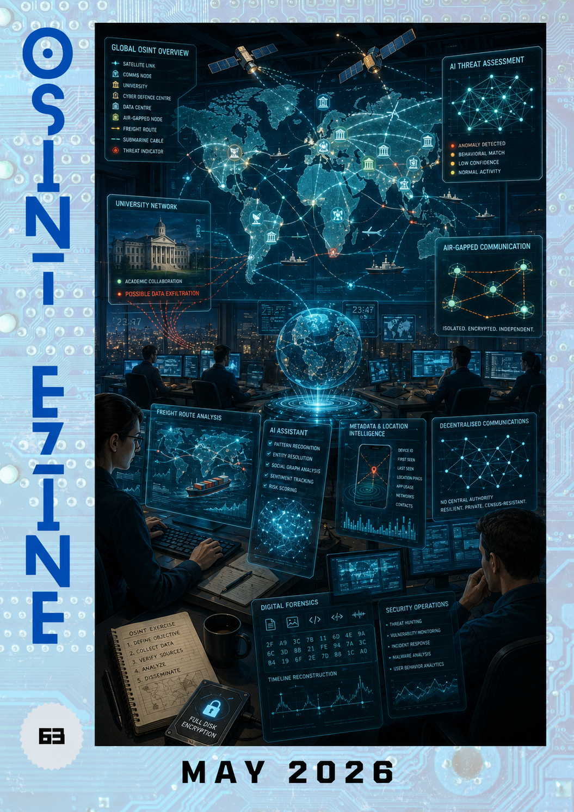

# 05 - May 2026

<figure><figcaption></figcaption></figure>

Welcome to the May issue of the OSINT eZine ([_#63_](https://therealguyinblack.gitbook.io/osint-ezine/osint-ezine/2026)). This issue includes topics such as AI transforming security operations; OpenAI's new Daybreak initiative; OSINT training resources; digital forensics without geolocation metadata; Russian intelligence recruitment pipelines; decentralised communications; AI privacy concerns; code words against AI impersonation; satellite-powered freight intelligence... and much more!

Hey Ho, Lets Go!:

* [AI: **Augmented SOC Analysts.**](05-may-2026.md#ai-augmented-soc-analysts)
* [AI: **OpenAI Daybreak.**](05-may-2026.md#ai-openai-daybreak)
* [Learning: **AI For Beginners.**](05-may-2026.md#learning-ai-for-beginners)
* [Learning: **Finding Previous Locations Without Geolocation Data.**](05-may-2026.md#learning-finding-previous-locations-without-geolocation-data)
* [Learning: **List of OSINT Exercises.**](05-may-2026.md#learning-list-of-osint-exercises)
* [Learning: **OSINT Training Courses.**](05-may-2026.md#learning-osint-training-courses)
* [News: **Children Bypass Age Verification Checks.**](05-may-2026.md#news-children-bypass-age-verification-checks)
* [News: **GRU University.**](05-may-2026.md#news-gru-university)
* [Privacy: **Air-Gapped Communications.**](05-may-2026.md#privacy-air-gapped-communications)
* [Privacy: **LeakyLM.**](05-may-2026.md#privacy-leakylm)
* [Privacy: **NostrMail.**](05-may-2026.md#privacy-nostrmail)
* [Techniques: **Cell Phone Privacy and Surveillance.**](05-may-2026.md#techniques-cell-phone-privacy-and-surveillance)
* [Techniques: **Code Words Are Back.**](05-may-2026.md#techniques-code-words-are-back)
* [Techniques: **From Hooligans to War Machines.**](05-may-2026.md#techniques-from-hooligans-to-war-machines)
* [Techniques: **Full Disk Encryption Tools.**](05-may-2026.md#techniques-full-disk-encryption-tools)
* [Tools: **DRISH-X.**](05-may-2026.md#tools-drish-x)
* [Tools: **Synthetic Exercise World Format.**](05-may-2026.md#tools-synthetic-exercise-world-format)

***

### AI: Augmented SOC Analysts.

Artificial intelligence is increasingly being integrated into Security Operations Centres (SOCs), helping analysts automate repetitive tasks, accelerate investigations and improve threat detection. Rather than replacing human expertise, AI is emerging as a force multiplier that allows defenders to focus on higher-value analytical work while reducing alert fatigue and operational overhead.

[https://www.sans.org/blog/augmented-analyst-how-ai-reshaping-security-operations-2026](https://www.sans.org/blog/augmented-analyst-how-ai-reshaping-security-operations-2026)

***

### AI: OpenAI Daybreak.

OpenAI introduced Daybreak, an initiative focused on advancing defensive cybersecurity capabilities through AI. The project explores how artificial intelligence can assist security professionals in identifying vulnerabilities, analysing software risks and strengthening secure development practices while maintaining a focus on authorised and defensive applications.

[https://openai.com/daybreak](https://openai.com/daybreak)

***

### Learning: AI For Beginners.

Microsoft's AI For Beginners is a free and comprehensive curriculum covering the fundamentals of artificial intelligence through practical lessons and examples. The course provides a structured introduction to machine learning, neural networks, natural language processing and other key concepts, making it valuable for both newcomers and professionals looking to expand their knowledge.

[https://github.com/microsoft/AI-For-Beginners](https://github.com/microsoft/AI-For-Beginners)

***

### Learning: Finding Previous Locations Without Geolocation Data.

Location data is not always available during a forensic examination, but other artefacts can often reveal where a device has previously been. This article explores techniques for identifying historical locations through indirect evidence, demonstrating how investigators can reconstruct movement patterns even when explicit geolocation records are unavailable.

[https://www.forensicfocus.com/articles/finding-previous-locations-without-geolocation-data/](https://www.forensicfocus.com/articles/finding-previous-locations-without-geolocation-data/)

***

### Learning: List of OSINT Exercises.

One of the best ways to improve OSINT skills is through practical exercises and investigations. This collection from @Gralhix compiles numerous challenges and exercises designed to help analysts practise information gathering, verification and analytical techniques in realistic scenarios.

[https://gralhix.com/list-of-osint-exercises/](https://gralhix.com/list-of-osint-exercises/)

***

### Learning: OSINT Training Courses.

Training is a fundamental part of becoming an effective investigator. ShadowDragon has compiled an extensive list of OSINT courses covering a wide range of topics and skill levels, providing a useful starting point for anyone looking to develop or expand their investigative capabilities.

[https://shadowdragon.io/resources/best-osint-training-courses/](https://shadowdragon.io/resources/best-osint-training-courses/)

***

### News: Children Bypass Age Verification Checks.

Age verification systems are becoming increasingly common as governments and platforms seek to protect younger users online. However, this report highlights how some children have successfully bypassed verification systems using simple disguises, raising questions about the reliability and effectiveness of current age assurance technologies.

[https://techcrunch.com/2026/05/06/some-kids-are-bypassing-age-verification-checks-with-a-fake-mustache/](https://techcrunch.com/2026/05/06/some-kids-are-bypassing-age-verification-checks-with-a-fake-mustache/)

***

### News: GRU University.

An investigation into Moscow's Bauman University explores allegations that Russian military intelligence services use academic institutions to identify and recruit future cyber operators and intelligence personnel. The report examines the intersection between higher education, state security structures and cyber operations.

[https://vsquare.org/welcome-to-the-gru-university-where-moscow-turns-students-into-spies-and-hackers-bauman-stupakov/](https://vsquare.org/welcome-to-the-gru-university-where-moscow-turns-students-into-spies-and-hackers-bauman-stupakov/)

***

### Privacy: Air-Gapped Communications.

Element discusses how secure communications can be deployed within highly sensitive and isolated environments. The article focuses on air-gapped communication architectures and their applicability to national security, defence and other sectors where information must remain separated from public networks.

[https://element.io/blog/air-gapped-communications-for-national-security/](https://element.io/blog/air-gapped-communications-for-national-security/)

***

### Privacy: LeakyLM.

LeakyLM examines privacy risks associated with large language models and AI assistants. The project highlights how sensitive information may be unintentionally exposed through interactions with AI systems and emphasises the need for stronger privacy safeguards when deploying these technologies.

[https://leakylm.github.io/#](https://leakylm.github.io)

***

### Privacy: NostrMail.

NostrMail aims to provide an email-like experience built on top of the decentralised Nostr protocol. By leveraging distributed infrastructure rather than traditional email providers, the project explores alternative approaches to censorship resistance, identity management and digital communications.

[https://nostrmail.org/](https://nostrmail.org/)

***

### Techniques: Cell Phone Privacy and Surveillance.

Mobile phones generate enormous amounts of data that can reveal a user's activities, contacts and locations. This article explores how information collected from smartphones can be leveraged during investigations and highlights the broader privacy implications associated with modern mobile devices.

[https://hackers-arise.com/cell-phone-privacy-how-law-enforcement-uses-your-cell-phone-to-invade-your-privacy/](https://hackers-arise.com/cell-phone-privacy-how-law-enforcement-uses-your-cell-phone-to-invade-your-privacy/)

***

### Techniques: Code Words Are Back.

The rapid improvement of AI-generated voice cloning and impersonation technologies is prompting a return to a surprisingly simple security practice: code words. This article discusses how pre-arranged phrases can help verify identities and reduce the effectiveness of social engineering attacks enabled by synthetic media.

[https://covertaccessteam.substack.com/p/code-words-are-back](https://covertaccessteam.substack.com/p/code-words-are-back)

***

### Techniques: From Hooligans to War Machines.

This investigative project examines the transformation of Russian football hooligan groups and their connections to military and paramilitary activities. Combining open-source research with extensive documentation, it provides insights into how informal networks can become integrated into broader conflict environments.

[https://spainrus.org/en](https://spainrus.org/en)

***

### Techniques: Full Disk Encryption Tools.

Full disk encryption remains one of the most effective ways to protect data stored on devices against theft, loss or unauthorised access. This overview compares several encryption solutions and outlines their strengths, helping users understand the options available for securing sensitive information.

[https://cybersecuritynews.com/best-full-disk-encryption-tools/](https://cybersecuritynews.com/best-full-disk-encryption-tools/)

***

### Tools: DRISH-X.

DRISH-X is an open-source intelligence tool that uses Sentinel-2 satellite imagery to analyse freight and logistics activity. By leveraging satellite data and automated processing, it enables analysts to monitor transportation patterns and identify trends relevant to supply chains, trade and strategic intelligence.

[https://github.com/sparkyniner/DRISH-X-Satellite-powered-freight-intelligence-](https://github.com/sparkyniner/DRISH-X-Satellite-powered-freight-intelligence-)

***

### Tools: Synthetic Exercise World Format.

The MISP Synthetic Exercise World Format provides a structured fictional environment for cyber exercises, training and simulations. It allows organisations to conduct realistic scenarios without relying on real-world entities, helping teams practise intelligence sharing, incident response and analytical workflows.

[https://github.com/MISP/Synthetic-Exercise-World-Format](https://github.com/MISP/Synthetic-Exercise-World-Format)

***

_Data is a tool for enhancing intuition._

_\~Hilary Mason. American Data Scientist._

