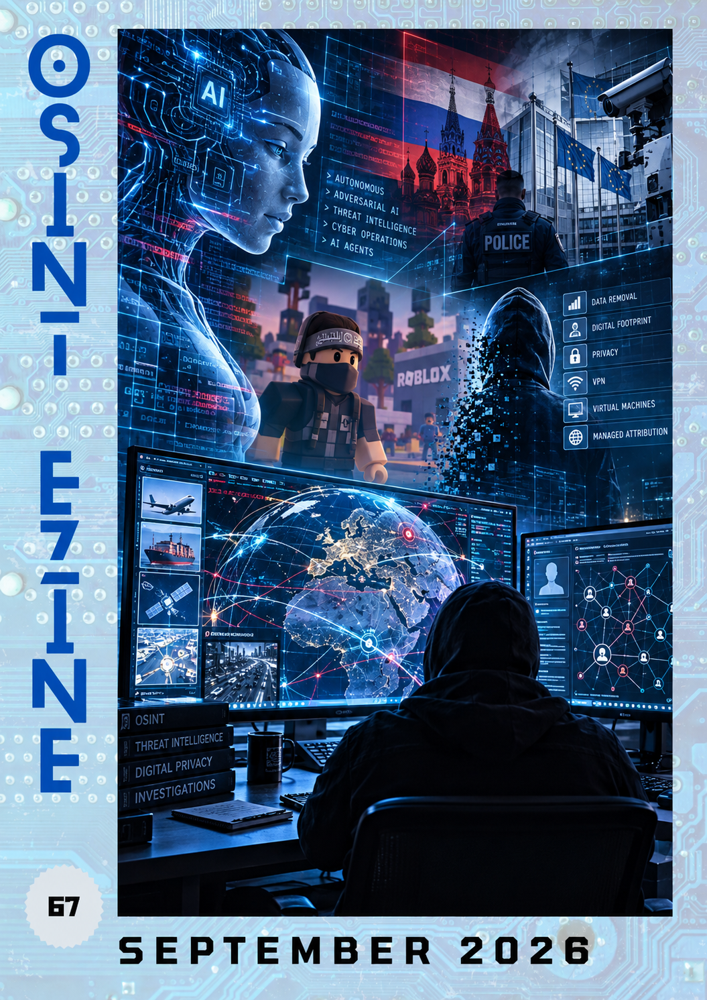

# 09 - September 2026

<figure><figcaption></figcaption></figure>

Welcome to the September issue of the OSINT eZine ([_#67_](https://therealguyinblack.gitbook.io/osint-ezine/osint-ezine/2026)). This issue includes topics such as the evolution of adversarial AI towards autonomous cyber operations; Anthropic's latest threat intelligence report; OSINT investigations using fashion and visual clues; privacy-enhancing technologies and their implications for law enforcement; virtual machines, VPNs and managed attribution; Russian surveillance technology in European law enforcement; protecting your digital footprint; extremist content in Roblox games; practical Maltego investigations; specialised browsers for OSINT; monitoring worldwide events through geospatial intelligence... and much more!

Hey Ho, Lets Go!:

* [AI: Adversarial AI Moves Towards Autonomy.](09-september-2026.md#ai-adversarial-ai-moves-towards-autonomy)
* [AI: Anthropic Report on Malicious AI Use.](09-september-2026.md#ai-anthropic-report-on-malicious-ai-use)
* [Learning: Fashion, Optics and OSINT Investigations.](09-september-2026.md#learning-fashion-optics-and-osint-investigations)
* [Learning: OSINT Analysis Techniques.](09-september-2026.md#learning-osint-analysis-techniques)
* [Learning: Privacy-Enhancing Technologies and Law Enforcement.](09-september-2026.md#learning-privacy-enhancing-technologies-and-law-enforcement)
* [Learning: Virtual Machines, VPNs and Managed Attribution.](09-september-2026.md#learning-virtual-machines-vpns-and-managed-attribution)
* [News: Russian Surveillance Technology in European Law Enforcement.](09-september-2026.md#news-russian-surveillance-technology-in-european-law-enforcement)
* [Privacy: Privacy Tips from Threema.](09-september-2026.md#privacy-privacy-tips-from-threema)
* [Techniques: Disappearing from OSINT.](09-september-2026.md#techniques-disappearing-from-osint)
* [Techniques: Extremist Content in Roblox Games.](09-september-2026.md#techniques-extremist-content-in-roblox-games)
* [Techniques: Maltego CTF Investigation Walkthrough.](09-september-2026.md#techniques-maltego-ctf-investigation-walkthrough)
* [Tools: God's Eye: Monitoring World Events.](09-september-2026.md#tools-gods-eye-monitoring-world-events)
* [Tools: Web Browsers for OSINT Investigators.](09-september-2026.md#tools-web-browsers-for-osint-investigators)
* [Looking Ahead: Looking Beyond OSINT.](09-september-2026.md#looking-ahead-looking-beyond-osint)

***

#### AI: Adversarial AI Moves Towards Autonomy.

Google Threat Intelligence Group (GTIG) examines how cyber threat actors are moving from simple AI prompting towards increasingly autonomous operations. The report describes AI-assisted credential harvesting, attacks targeting coding assistants and software supply chains, and attempts to exploit AI systems themselves. These developments highlight how autonomous agents can accelerate malicious activities and reduce the time available for defenders to detect and respond to cyber threats.

[https://cloud.google.com/blog/topics/threat-intelligence/from-prompting-to-autonomy-the-evolution-of-adversarial-ai](https://cloud.google.com/blog/topics/threat-intelligence/from-prompting-to-autonomy-the-evolution-of-adversarial-ai)

***

#### AI: Anthropic Report on Malicious AI Use.

Anthropic's September 2026 threat intelligence report examines how malicious actors are incorporating artificial intelligence into cyber operations, including espionage, automated reconnaissance, phishing and malware development. The research highlights cases where AI-assisted systems can adapt their behaviour and modify malicious tools in response to security detections. For cybersecurity and law enforcement professionals, the report provides insights into how increasingly autonomous AI capabilities may transform the scale and complexity of cyber threats.

[https://www.anthropic.com/threat-intelligence-report-september-2026](https://www.anthropic.com/threat-intelligence-report-september-2026)

***

#### Learning: Fashion, Optics and OSINT Investigations.

OSINT investigator MJ Banias presents a practical case study demonstrating how apparently unrelated information can contribute to an investigation. Using a Canadian corporate investigation as its starting point, the article explores the limitations of business registries and the importance of combining documentary evidence with additional open sources. It provides an interesting example of why investigators should question individual records, explore alternative leads and corroborate findings before reaching conclusions.

[https://www.bullshithunting.com/p/a-free-osint-lesson-fashion-optics](https://www.bullshithunting.com/p/a-free-osint-lesson-fashion-optics)

***

#### Learning: OSINT Analysis Techniques.

ShadowDragon presents ten techniques for transforming collected open-source information into actionable intelligence. The guide covers link analysis, timeline reconstruction, identity correlation, geolocation, social network analysis, metadata examination and cross-source verification. It emphasises the importance of structured analytical processes to reduce false positives, identify relationships between entities and produce reliable findings for law enforcement, cybersecurity and intelligence investigations.

[https://shadowdragon.io/resources/osint-analysis/](https://shadowdragon.io/resources/osint-analysis/)

***

#### Learning: Privacy-Enhancing Technologies and Law Enforcement.

Europol and the European Commission's Joint Research Centre (JRC) examine emerging privacy-enhancing technologies and their potential implications for law enforcement. The publication explores how technological developments designed to protect personal information may influence investigative capabilities, data accessibility and future regulatory challenges. It provides an interesting reference for understanding the balance between privacy, fundamental rights and the operational requirements of criminal investigations.

[https://www.europol.europa.eu/publications-events/publications/horizon-scanning-emerging-privacy-enhancement-technologies#downloads](https://www.europol.europa.eu/publications-events/publications/horizon-scanning-emerging-privacy-enhancement-technologies#downloads)

***

#### Learning: Virtual Machines, VPNs and Managed Attribution.

Authentic8 compares three technologies frequently used to protect investigators conducting online research: virtual machines, VPNs and managed attribution environments. Although these solutions are sometimes treated as interchangeable, each addresses different aspects of security, isolation and online identity. The article explains their respective capabilities and limitations, including browser fingerprinting, network exposure and endpoint protection, helping investigators understand why operational security requires more than simply hiding an IP address.

[https://authentic8.com/blog/vm-vs-vpn-vs-managed-attribution/](https://authentic8.com/blog/vm-vs-vpn-vs-managed-attribution/)

***

#### News: Russian Surveillance Technology in European Law Enforcement.

A POLITICO investigation raises concerns about the reported presence of technology supplied by a Russian surveillance company within European law enforcement agencies. The subject highlights the importance of examining technology suppliers, ownership structures and potential foreign influence when procuring sensitive investigative systems. Such dependencies can create significant questions about data protection, operational security and institutional oversight, particularly when technologies process sensitive law enforcement information.

[https://www.politico.eu/article/russia-tech-surveillance-company-infiltrated-europes-law-enforcement-agencies/](https://www.politico.eu/article/russia-tech-surveillance-company-infiltrated-europes-law-enforcement-agencies/)

***

#### Privacy: Privacy Tips from Threema.

Threema, the Swiss privacy-oriented messaging service, shares practical recommendations to help users improve their online privacy and reduce their digital footprint. The article covers measures such as using unique passwords, keeping software updated, reviewing privacy settings and selecting services that minimise unnecessary personal data collection. Although some recommendations may appear basic, they provide a useful reminder that effective privacy protection depends on consistent digital habits rather than relying exclusively on specialised technologies.

[https://threema.com/en/blog/privacy-tips-part-1](https://threema.com/en/blog/privacy-tips-part-1)

***

#### Techniques: Disappearing from OSINT.

Every online interaction can contribute to a digital footprint that may eventually be discovered through open-source investigations. Brian Harris explores how the same OSINT techniques used to investigate individuals can also help people identify and reduce their own publicly accessible information. The article recommends reviewing personal exposure, checking commonly used investigative services and requesting the removal of unnecessary records where possible. Complete anonymity cannot be guaranteed, but understanding how investigators collect information is an important step towards improving personal OPSEC.

[https://covertaccessteam.substack.com/p/disappearing-from-osint](https://covertaccessteam.substack.com/p/disappearing-from-osint)

***

#### Techniques: Extremist Content in Roblox Games.

The Global Network on Extremism and Technology (GNET) examines how jihadist imagery and ideological references appear within Roblox, a gaming platform particularly popular among minors. The research identifies the use of virtual clothing, gaming environments and audiovisual elements associated with terrorist organisations, alongside the redistribution of related material through platforms such as TikTok and Discord. The study highlights the challenges of identifying extremist propaganda embedded within gaming culture and the importance of understanding how extremist narratives can reach younger audiences through seemingly harmless online environments.

[https://gnet-research.org/2026/09/02/playful-extremism-unmasking-jihadist-identifiers-in-roblox-games-among-minors/](https://gnet-research.org/2026/09/02/playful-extremism-unmasking-jihadist-identifiers-in-roblox-games-among-minors/)

***

#### Techniques: Maltego CTF Investigation Walkthrough.

Maltego shares a walkthrough of Qualifier A from its 2026 Capture the Flag Championship, where participants faced 60 investigative challenges covering geolocation, chronolocation, maritime and aviation tracking, social media analysis, due diligence and brand protection. The article demonstrates how different OSINT techniques and sources can be combined to solve investigative problems. It is a useful resource for practitioners interested in testing their analytical skills, comparing investigative approaches and improving their familiarity with Maltego and other OSINT resources.

[https://www.maltego.com/blog/maltego-ctf-championship-qualifier-a-challenge-walkthrough/](https://www.maltego.com/blog/maltego-ctf-championship-qualifier-a-challenge-walkthrough/)

***

#### Tools: God's Eye: Monitoring World Events.

God's Eye is a browser-based geospatial visualisation project that combines publicly available information within an interactive three-dimensional globe. The platform can display information relating to aircraft, maritime traffic, satellites, earthquakes and public traffic cameras, providing a useful environment for monitoring worldwide developments. Hackers Arise introduces a community-maintained version designed to operate without the paid APIs required by the original project. For OSINT investigators, the platform illustrates how multiple open data sources can be combined to support situational awareness and geospatial analysis.

[https://hackers-arise.com/osint-monitoring-world-events-with-gods-eye/](https://hackers-arise.com/osint-monitoring-world-events-with-gods-eye/)

***

#### Tools: Web Browsers for OSINT Investigators.

Selecting an appropriate browser environment is an important consideration when conducting investigations involving sensitive information or potentially hostile websites. OSINT Me compares specialised solutions including Authentic8 Silo, Ntrepid Nfusion, Menlo Security, Ericom Shield and Kasm Workspaces, examining their approaches to remote browser isolation, managed attribution and disposable investigative environments. The article also discusses evidence collection solutions such as Hunchly, Forensic OSINT and Paliscope, providing an overview of technologies that can strengthen investigative OPSEC and evidence management.

[https://osintme.com/index.php/2026/09/30/web-browsers-for-osint-investigators/](https://osintme.com/index.php/2026/09/30/web-browsers-for-osint-investigators/)

***

#### Looking Ahead: Looking Beyond OSINT.

While OSINT remains an important discipline, many of the topics that currently capture my attention sit at the intersection of intelligence, security, defence, technology and data. In recent months I have been exploring ways to bring these domains together under a more unified framework.

***

_The goal is to turn data into information, and information into insight._

_\~Carly Fiorina, American businesswoman and politician._
